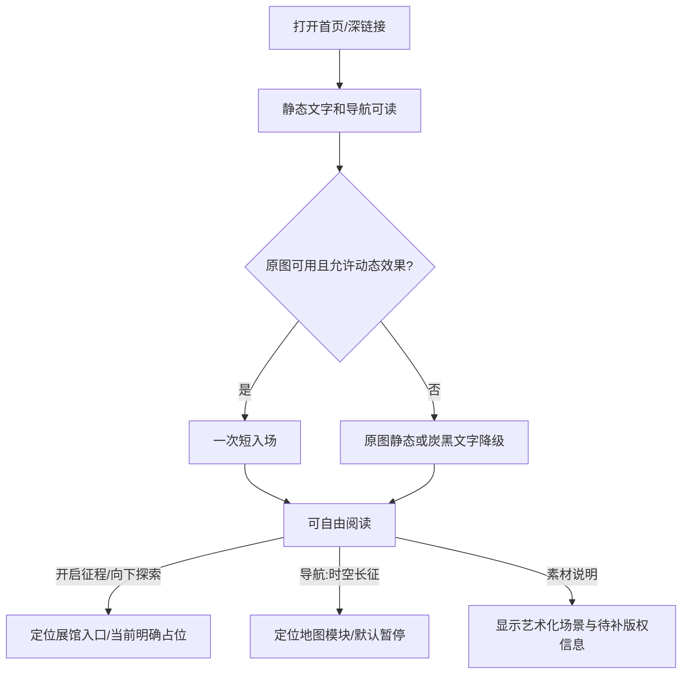
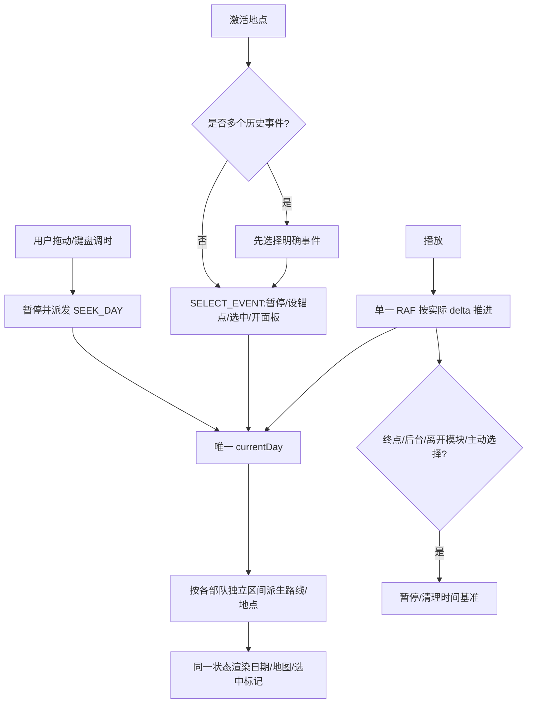

# 交互设计说明

2026-11-18第四章答卷：左侧选词/书写，右侧实时本机Canvas，未选词为明确标记的示例。确认生成后保存完整PNG；改字或改词撤下过期下载，草稿保留，异步结果有失效与Blob清理。200字素/IME/不上传不持久化/可跳过、HTTP复制备用继续保留；方向变化只影响布局。见[最终精修](LEGACY_FINAL_POLISH.md)，不增加历史日期或播放时钟。

2026-11-16双端补记：手机横屏是正式目标。OrientationGuide统一检测视口与触摸，旋转仅更新布局；同一地图/首页实例保持，唯一日期、筛选、选中事件不重置。地图画布接管单/双指，资料面板独立纵滚，时间轴控制组横滚，侧栏可收起；展厅保持固定返回和完整内容。新交互必须提供触摸等效入口。详见[实施与验收](MOBILE_LANDSCAPE.md)。

2026-11-15地图精修：currentDay仍唯一；routeFocus只是展示标记。选事件强调已展开的关联段，主动总览恢复多军比较并清除选军强调，播放按当前区间强调。总览明确包含1936年，演进先按日期裁切再显示层级。四渡专题全程对照与具体渡河演进说明分开；导览卡打开原展厅，普通关闭不调地图。1936接应标签原生按钮支持键盘说明/关闭。见[本轮记录](MAP_REFINEMENT_20261115.md)。

2026-11-14完整专题：四渡各次仍为独立事件，“阅读四渡赤水完整专题”进入六场景。IntersectionObserver只改变局部sceneId与从既有路线派生的方向图，不写currentDay。点击图点/章节入口只翻读，明确点击“在长征地图中查看”才走原select契约；普通关闭恢复原地图与焦点。12个迁移读本通过折叠专题目录/兼容检索访问，原38项地理精选规则保留。详见[深化实现](HISTORY_EXHIBITION_DEEPENING.md)。

2026-11-14第二轮：本机普通展示与显式review=1审核模式分离，review=0/远程保留正式资料门槛。专题路线图可“返回地图对照”，关闭并聚焦原选中点；与后台事件不一致时不显示该入口，镜头、缩放、日期和部队筛选均不改变。图像适应窗口完整显示，放大后才滚动。普通关闭继续恢复原入口。见[专题精修](HISTORY_EXHIBITION_SAMPLE.md)。

2026-11-14一渡专题展厅：约92%视口、独立滚动、上沿返回地图、文末编辑式前后阅读；图片以独立黑色展墙打开，前后切换、查看区方向键与放大滚动。地图实例与唯一日期不由阅读驱动。样板新增本机审阅/访客呈现判断，待审影像与长篇草稿仅在本机审阅展示。见[专题交互与验证](HISTORY_EXHIBITION_SAMPLE.md)。其他事件维持此前阅读版式。

2026-11-14四渡专题修复：专题导航状态与时间模式分开。选择一至四渡仍调唯一日期、裁剪当日路线，但专题保留四个渡河地域入口，未到日期的节点明确标“待到达”。点击普通“时间演进”、全程总览、其他事件或历史阶段退出专题，恢复普通未来事件过滤；部队筛选继续有效。

2026-11-14档案阅读升级：右侧速览与大尺寸模态阅读分层，原生dialog焦点约束、独立滚动、图片放大分层关闭；阅读内前后事件不调地图日期或镜头，关闭恢复入口焦点。详见[一渡赤水样板](HISTORY_ARCHIVE_SAMPLE.md)。本条取代下文仅窄栏阅读的旧方案。

2026-11-12最新：默认改为长征沿线局部视野，首屏9组关键节点、0个常驻地名，放大后分级展开；1936接应线独立开关。运行时157项事件、81项地域定位、75处未定位、38项精选，81段方向组成17条笔画。七项路线复核、来源限制与最终验证见[沿线视野与七项路线复核](MAP_ROUTE_AUDIT_20261112.md)。下文全国全图/六标签及旧计数保留为阶段沿革，以本条为准。

2026-11-12更新采用中国整幅排版、暖红边界、六个关键地名及缩放分级标注。规则折线改为浅淡不规则皱痕，详见[中国整幅地图](MAP_CHINA_SHEET.md)。

2026-11-11更新：底部92px统一控制带，仅一条日期滑轨。拖动自动进入时间演进，唯一currentDay在播放时允许小数日、由单一RAF最多20Hz发布，路线按线长逐段显现；暂停冻结当前线端，事件/键盘仍按日期锚点选择。四渡赤水专题先给全程地域总览，四步事件点击自动切入对应时间，二渡/四渡及两次遵义访问不合并。EVT-029原“2月下旬”保留，单列2月28日阶段收束显示锚点，统一通过eventDay派生，不另设地图日期。左侧四军勾选、图例、折叠阶段及所有原播放/导航功能保持，右侧精选24项，原156项资料不删。详见 [MAP_CHISHUI_ENRICHMENT.md](MAP_CHISHUI_ENRICHMENT.md)，此前四泳道与单看按钮为历史方案。

版本：0.4；2026-11-10补充：本次用户确定全屏Terrain、左右浮层与底部Parallel四泳道，速度1×/2×/4×；这些选择取代下文旧的上方时间轴和0.5×候选。唯一currentDay、后台暂停、筛选不改日期等约束保持。当前实现与限制见 [MAP_DEVELOPMENT.md](MAP_DEVELOPMENT.md)，实际验证见 [MAP_VALIDATION.md](MAP_VALIDATION.md)。未开展手机专属适配。

## 入口与滚动叙事

首页静态内容渐进增强为短入场，提供“开启征程”、四项章节导航和可点击滚动提示。已移除片头跳过按钮、状态、样式与逻辑，原片头最长 2.2 秒不延长。资源失败或减少动态效果时可直接阅读；缩窗允许纵向阅读。

用户滚动章节只改变阅读位置。历史模拟时间由地图时间轴、事件选择、播放控制改变，避免同时存在滚动和播放两套时钟。离开地图模块暂停；返回仍保持日期与筛选，不自动恢复播放。

## 时空长征布局

桌面：上方历史时间轴，中央完整地图，右侧资料栏，下方播放与部队筛选。右侧列宽在打开前后保持，避免面板动画反复改变地图比例；必要时只调整地图内部视野，不遮住核心控件。

缩窗：地图与资料栏改为页面内上下堆叠，事件列表提供等价操作，详情为非模态阅读区域。底部对话框仅保留未来手机适配候选，当前不实现 inert、手势关闭或手机专属焦点逻辑。

## 统一状态和事件

| 输入 | 状态变化 | 必须满足的约束 |
| --- | --- | --- |
| SEEK_DAY(day) | 裁剪到全局有效范围并更新 currentDay | 同一帧派生所有路线、标记；不另存地图时间 |
| DRAG_START | 暂停，记录拖动状态 | 捕获 pointer；拖动不触发页面平滑滚动 |
| DRAG_MOVE | 根据指针计算日序，更新 SEEK_DAY | 每 RAF 至多处理一次最新位置，显示当前日期 |
| DRAG_END / CANCEL | 提交最后日期，结束捕获 | 保持暂停，用户明确点击才再播放；取消也不能遗留拖动状态 |
| SELECT_EVENT(id) | 暂停、定位事件展示锚点、选中事件和地点、打开面板 | 一个原子 action，不靠两个 effect 互相监听同步 |
| SELECT_PLACE(id) | 单事件直接选择，多事件先列日期选择器 | 多日期地点不擅自选定首次发生日期 |
| PLAY / PAUSE | 更改播放状态，重置时钟基准 | 终点按 PLAY 从起点重播，先向用户明确显示“重播” |
| SET_SPEED(value) | 切换 0.5×/1×/2× | 不重置日期；禁止重复建立 RAF |
| TOGGLE_ARMY(id) | 仅改变可见集合 | 不改变日期；若详情仅属于隐藏部队则关闭详情并说明 |
| ENTER_SOLO / EXIT_SOLO | 保存/恢复筛选和视野 | P2；不改全局时间，不误覆盖用户日期选择 |
| CLOSE_DETAIL | 清空选中事件/地点 | 保留日期与筛选，焦点返回触发控件 |
| VISIBILITY_HIDDEN / UNMOUNT | 暂停并清理时钟 | 恢复前台不追赶后台经过的时间 |

拖动时间轴支持 Pointer Events，处理 pointercancel。键盘提供方向键逐日、PageUp/PageDown 按较大步长、Home/End 到起止点，以及前后事件按钮；细步长与大步长需在原型中说明。滑块提供 aria-valuemin/max/now 和 aria-valuetext 日期；屏幕阅读器播报节流到停止拖动或关键节点，不能每帧刷屏。

## 多部队路线规则

1. 全局范围由经审核的数据有效区间求并集，不假设所有部队同时开始和结束。
2. 日期早于某支部队有效起点：不显示该部队轨迹，图例显示“尚未进入本路线时间范围”。晚于终点：保留完整轨迹并标识结束。
3. 到达节点之间按分段时间推进；停驻期间路线不延伸；退拖时撤销未来段和未来地点。存在时间缺口时不制造精确运动。
4. 插值仅用于表达时间进展，面板和图例明确“路线示意/节点级”，不能宣称当日精确位置。
5. 部队颜色固定，配线型和文字；交汇地点显示各部队各自到达的事件，不通过坐标接近自动推断会师。
6. 编制与名称变化由有效时期决定，关联前身/后继关系，不共用一个永久名称掩盖历史差异。

## 地点、详情与时间双向联动

地点在其关联的第一条可展示事件达到 revealDay 后出现；同地点后续事件只在已发生/可查看列表中显示。选中列表中的明确事件，可主动调时到其锚点。对仅精确到月或区间的事件，显示完整日期文本和“按区间起点定位”的说明；锚点不是新增史实。

点击地点后先停止播放，再执行 SELECT_EVENT；资料面板显示标题、原始日期、部队、背景、图像及来源。定位完成不自动播放。时间轴拖至其他时间：如选择事件已在未来则关闭详情，避免未来信息残留；已发生事件可保持，但显示事件日期与当前日期的区别。

普通探索不强制更改筛选。如果来自其他模块的“查看地图”指向隐藏部队，则明确显示“显示相关部队并定位”，用户触发该操作才把相关部队加入集合。部队全部关闭时保留时间控制和空状态，提供恢复全部按钮。

## 自动播放计算

候选基础速率为 1× 每秒推进 7 个历史日，待原型评估；0.5×、2×为相对倍率。使用单一 RAF 累积实际 delta，支持小数内部进度，展示和事件判定基于整日。不以屏幕帧数决定速度。最后一帧精确钳制到终点后暂停，重播明确从起点开始。暂停和倍速切换重新建立基准时间，不能发生时间跳跃。

## 降级与边界

- 减少动态效果不影响历史播放的显式操作，但取消装饰视差和自动飞行镜头。
- 地图缩放/拖动与页面滚动分开；只有地图操作区拦截必要事件，不锁住整页。
- 空数据/未核实地点不进入正式选择列表；可显示“资料待补充”，不能伪造位置。
- URL 可选保存日期、部队和事件；参数需校验，非法参数回退默认暂停态。默认日期取审核数据起点。
- 深链接不得让未来事件在较早时间偷偷显现；加载完成后用一个 action 解析并恢复一致状态。

第 5—7 天重点验证：拖动可逆、跨部队不同起止时间、同地点多事件、播放终点、隐藏选中部队、后台恢复、键盘与桌面鼠标/触控板，详见 [测试计划](TEST_PLAN.md)。

## Day 2 首页完整交互流程

首页已选择 A，历史 B 记录见 [DESIGN_SYSTEM.md](DESIGN_SYSTEM.md)，保留原有导航和进入展馆语义。初始状态为 static-ready；文字与导航从 DOM 初始内容即可读取。图片可用时才进入短暂 intro 动效，失败进入 static-fallback，不能出现不可退出的全屏遮挡。关键资源未就绪时主按钮仍可操作，不伪造百分比。



“开启征程”定位展馆入口，不暗示地图或影片已经实现；未来地图默认暂停。链接激活后焦点放到目标区域，普通滚动不转移焦点；“向下探索”是真实链接。保留修饰键/中键原生行为。

导航为：首页、时空长征、英雄人物、精神传承；三处后续占位与导航共用数据源。独立时间轴/历史瞬间入口移除，旧 #entrance-timeline / #entrance-moments 规范化为 #entrance-journey；它们不是保留的独立路由。选中入口更新 aria-current 与 URL，返回首页清除选中；影像说明支持关闭、Escape 和焦点恢复。

环境动画在片头完成且分层就绪后自动启动，与历史模拟播放完全分离。2026-11-08 用户确认旗面采用唯一 16px 中等档、8 秒连续周期；连接区/旗杆/人物固定，旗帜自由边缘可运动。单个“暂停环境动效/播放环境动效”按钮同时冻结或恢复旗帜、云雾、朝阳，保留当前帧。仅完全离屏或 document.hidden 暂停；返回不追赶时间，且不覆盖手动暂停选择。reduce 不创建持续时钟；卸载清理 ticker、媒体查询、IntersectionObserver、visibilitychange、ResizeObserver 与 GPU 资源。WebGL 初始化、纹理或 Context Lost 失败时整体显示原始完整图。

## Day 2 地图布局与信息层级

### 桌面主布局（1920×1080 与 1366×768）

```text
┌ 标题:时空长征                  资料精度/使用说明 ┐
│ 当前日期      前一事件 ──时间轴── 后一事件       │
├────────────────────────┬───────────────────────┤
│ 完整中国地图            │ 历史资料栏            │
│                        │ 未选中:操作说明       │
│ 多部队轨迹 / 地点       │ 已选中:事件档案       │
│ 缩放、复位 / 必要附图   │ 日期/部队/来源/关闭   │
├────────────────────────┴───────────────────────┤
│ 播放/暂停  0.5× 1× 2×   部队筛选（可换行）     │
└────────────────────────────────────────────────┘
```

1920 画幅内容最大 1728px：右栏 360—400px、间隔 24px，地图优先占余下的大面积，建议高 560—640px。1366 画幅两侧 48px，右栏 320px，地图约 926px 宽，建议高 340—420px。上方时间轴 72—96px、下方控件 64—80px；实际浏览器内容高度不足时自然纵向滚动，不裁断播放控件。不能把显示器尺寸等同浏览器视口。

侧栏初始显示简短操作说明与精度说明，选择后在同一列替换为资料；它不是遮盖地图的悬浮广告层。按“关闭”恢复说明并保留日期与筛选。若未来需要地图扩大模式，必须有显式“扩大地图/恢复布局”，不作为当前 P0 隐藏功能。

地图以正规完整底图为初始视野，路线局部缩放是可选探索，不把完整地图切为只剩路径的缩略图。保留复位按钮、文字事件列表和来源入口；底图加载失败时显示事件列表，不能用随手画的轮廓冒充准确地图。

### 桌面缩窗与未来小屏候选

窗口低于约 1100px 可将右栏移到地图下方的普通文档流，导航和筛选换行，地图保持 max-width:100%、复位/缩放入口可见；800×600 不追求宽屏排布，允许纵向阅读。鼠标拖动地图、滚轮/按钮缩放与键盘事件列表是优先操作；不开发显式手机“移动地图”模式、手势关闭和底部抽屉。

用户原则认可的小屏完整影像带、底部资料对话框保留为未来候选。只有另行启动手机适配后才设计和验证其可读性、操作便利、关闭与焦点管理以及地图可视面积；当前没有手机验证结果，也不把这些作为本轮交付阻碍。

## 时间轴刻度与操作反馈

时间范围取所有审核部队数据区间的并集，初始日为其最早有效锚点，不预填统一出发年份或日期。所有日期统一以公历格式展示，精确到月/区间时显示原始精度与锚点说明；暂定 1936—2026 只用于首页纪念文案，绝不作为地图时间范围。

- 桌面优先按年显示主刻度、按季/月根据空间自动抽稀，缩窗保留起止与当前时间，不缩小到不可读字号。事件节点聚集用“该时段 n 项事件”列表入口，n 从真实数据计算。
- 当前日期黑体 20px，主滑块可见 16px、命中区 44px。重要事件刻度是短线/小点，与部队颜色、拖动把手区别；鼠标悬停可显示标题，键盘聚焦提供同样信息。
- 方向键逐日，PageUp/PageDown 暂定 30 日，Home/End 到界限；前/后事件按钮定位审核事件而非机械加一天。操作说明可展开，键盘不得被平滑滚动截获。
- 输入即时更新日期与派生路线。拖动时暂停并只保留最后一个待绘制位置，每帧最多一次更新；不在 pointerup 后额外缓动到另一日期。进度百分比表示展示时间进度，不表示历史路程或历史完成度。
- 日期有效边界的前后按钮 disabled 并保留解释；缺日期事件留在资料列表，不制造精确位置以适配时间轴。

## 地图路线、标记与筛选细则

四部队候选配色、符号与对比度见设计系统。默认展示全部有合格数据的部队，名称取当日有效番号；四个候选身份不得被误当四条已经核实的历史路线。

- 路线常态 2.5px、选中 4px，底衬深色线比主体宽 3px，缩放后保持屏幕可辨粗细。未选路线保留可读对比度，不统一降成近乎消失的低透明线。
- 交叉点选择先列相关部队/事件；聚集标签在屏幕坐标中避让，用引线联系实际点，不移动历史经纬度；缩放时更新避让，键盘列表无需依赖避让算法。
- 当前“行军进度”以所属部队形状+文字高亮，不称“当日精确位置”，除非数据本身支持该精度。停驻时不移动；缺口不做流光穿越；没有数据不做精确插值。
- 起点用空心部队形状、终点用双轮廓相同形状；会师地点用共享外环和相关事件列表，并明确参与部队与各自日期。会师图标的出现必须由核实事件驱动，不根据路线交叉自动生成。
- 筛选使用可切换按钮/复选框，含完整名称、符号和选中勾；未显示状态保留边框与“已隐藏”语义。有资料缺口/数据未就绪的部队显示说明，不伪造空轨迹为完整路线。
- 全部关闭时地图底图与时间保持，显示“暂无可见部队”及“显示全部”按钮。隐藏所属部队使当前档案失去全部可见关联时，关闭档案、清理选择并简短播报原因，焦点回筛选。
- 单部队模式为 P2：保存此前筛选和视野；仅改变可见集合和可选视野，退出恢复；日期继续来自唯一 currentDay。

## 历史资料卡片结构与状态

资料顺序：地点名称→事件名称→原始历史日期/精度→相关部队→图片及类型/署名→事件简介→历史背景→历史意义→资料来源。采用有小标题的阅读段落，不把每段又包成子卡片。图片无权限或缺失时直接用文字，不显示假照片占位。来源包括资料标题、机构、网页链接/页码、审核状态；外链有明确语义。

| 状态 | 展示与行为 | 焦点/播放 |
| --- | --- | --- |
| closed | 桌面显示操作说明；缩窗也使用文档流资料区域 | 日期与筛选保留 |
| choosing-event | 同地点多个事件，先展示各自日期与标题 | 暂停，不猜选首日；可返回 |
| opening | 使用已选事件填充固定区域，280ms 局部转场 | 播放已暂停；不等动画结束才显示内容 |
| ready | 全文、图片、引用、关闭可用 | 桌面非模态不困住 Tab；键盘选中可焦点到标题，指针激活不突然抢走焦点 |
| loading-media | 正文和来源立即可读，预留图片比例 | 不用大遮罩盖住全文 |
| media-error | 显示“图片未能加载”和既有署名，保留正文 | 可重试；不得永久旋转 |
| data-error | 显示“资料暂不可用”、返回列表或关闭 | 不改变 currentDay，不以未经审核内容填充 |
| closing | 180—220ms 淡出；reduce 立即关闭 | 关闭后恢复触发点；触发点消失则回事件列表标题 |

动画开合期间的重复点击以最新有效选择为准，取消旧媒体任务/回调，不把前一个事件的图像错配到新资料。当前非模态资料栏不建立全局焦点陷阱；未来手机对话框若获准另行设计。

## 双向联动与播放状态流程



基本状态：paused、playing、dragging、ended；档案状态与播放状态正交存储，但 SELECT_EVENT 必先暂停。状态转换：paused→PLAY→playing；playing→PAUSE/选择事件/后台→paused；任意可交互态→DRAG_START→dragging→DRAG_END/CANCEL→paused；playing 到终点→ended；ended 的按钮明确显示“从头播放”，主动触发后复位并播放。

播放默认暂停，倍率 0.5×/1×/2×为单选；基础候选仍为每秒 7 个历史日，Day 5 依据可读性调整。关键事件到达时给予一次静态日期提示和“查看资料”入口，不自动打开大面板、不夺焦点、不自动飞行地图；多个事件跨帧到达合并计数，完整历史事件可在列表查阅。任何自动提示不可盖住暂停按钮。

播放日期与路线在同一状态帧派生，不先播装饰路径再补日期。暂停立即停止进度，不等待面板/路线动画结束。reduce 模式保留用户明确触发的历史模拟播放，但禁用装饰视差、呼吸光和飞行镜头；播放本身有持续可见暂停入口。关闭资料后不会偷偷恢复播放。

## 无障碍、异常与验收补充

当前节点/日期的可访问名称含部队、事件和日期精度；屏幕阅读器在停止拖动或用户选择时播报，自动播放不每帧打断阅读。地图提供同等可操作的事件列表；与时间轴共用状态，不复制第二套选中逻辑。

加载空数据时控件禁用并解释，无审核数据时不播放；资源超时不影响正文；非法 URL 值裁剪/回退默认暂停；隐藏部队深链接须通过明确“显示相关部队并定位”操作才改变集合。缩窗、字体加载失败、图片失败和减少动态效果都保留关闭、复位、来源和前后事件入口。

本轮验收限文档：A 已选，标题字体与细节未定稿、未实现页面；Day 3 检查首页真实裁剪与对比度，Day 5—7 按 TEST_PLAN 的 T-MAP/T-PLAY/T-A11Y 用例测试；尺寸提案不能冒充浏览器和设备实测结果。

> 2026-11-16 实施补记：新EVT-058展厅导览仅滚动并聚焦章节，局部部队强调仅改变SVG视觉权重，不驱动全局currentDay。普通关闭、图片返回、前后阅读及“返回原地图对照地域”保持原地图画布、镜头、缩放、日期和筛选；回图对照聚焦原事件标记。无第二播放时钟。实际验证见[试点交付记录](ADAPTIVE_EXHIBITION_PILOT.md)。

> 2026-11-16 冲刺补记：右侧“深入了解”位于基本信息之后、简介/影像之前，并在右栏内吸附；换事件时只将右栏归顶。镜头跟随使用独立的followArmyId和当前部队同源展开端点，暂停调时也更新中心、不改zoom；多军无明确目标时由用户选择，隐藏目标/手动拖图/总览/重置关闭跟随。EVT-056/057经授权采用各自会议档案叙事，未迁移行军节点。实际证据见[三项交付记录](DELIVERY_SPRINT_20261116.md)。
# 2026-11-16 人物馆交互增量

肖像墙与八份人物档案为独立hash地址，真实a导航可刷新/回退/新窗口；首次入场约2.5秒，返回不重播，点击聚焦转场1050ms、Escape可取消；减少动态直接进入。环境光有暂停入口，后台及离页暂停/取消未完成转场。图片使用可关闭/Escape/焦点恢复的原图dialog，主体档案不是弹窗。人物关联事件只调用地图现有选择/显军/日期/定位逻辑；关闭或离开人物馆不销毁地图。横屏四列双排、档案图文并列，竖屏独立重排。详见[人物馆记录](PEOPLE_MEMORIAL.md)。

> 2026-11-17覆盖上述首轮参数：16人四列四排，按实际contain图像测量的共享肖像打开约880ms/返回约660ms，跨人物为淡入；16秒全墙暖光及基础静态照明，暂停/后台/reduce可中断。地图与人物馆双向直接导航；地图激活只resize，显式camera.key变化才fit，避免返回重置手动缩放。分期职务、长文、关键瞬间与来源折叠独立阅读，段内可关联已有地图事件；不另设历史时钟。见[第二轮实施与证据](PEOPLE_MEMORIAL_ROUND2.md)。

## 2026-11-17 第四章青春答卷

`#legacy`及六个`#legacy/章节`与现有hash路由并存；首次访问懒加载，站内离开后保留挂载，不因旋转重建地图/答卷。普通章节滚动不调历史日期，只有已有事件链接才用原地图选择机制。青春答卷为选词→解释/书写→本地Canvas完整PNG→下载/复制/重写/跳过；200字、换行与IME保护，无身份采集、后端、上传或持久存储。刷新清除有事先说明；站内切换保留文字。图片、字体、导出与HTTP Clipboard失败均有可阅读/可复制后备。具体流程、清理和测试见[精神传承](LEGACY_CHAPTER.md)。

## 2026-11-18 动效与镜头所有权

四章hash导航立即生效、保留挂载及浏览器历史，短遮幕不截获输入；快速导航替换旧动效。人物开合及前后退可取消，肖像墙滚动和焦点恢复；历史档案使用380ms进入/260ms关闭，事件切换可替换关闭任务。明确定位节点时关闭旧镜头跟随，但保留明确部队目标供重新开启；主动拖图结束跟随。滚动精神之路仅控制展陈红线，不影响唯一currentDay。生成纪念笺始终从完整Canvas保存，页面显影不阻塞保存/编辑。后台有限动效落最终态，环境光与历史时钟按原规则暂停、不追赶。见[统一动效实现](MOTION_UNIFICATION.md)。
