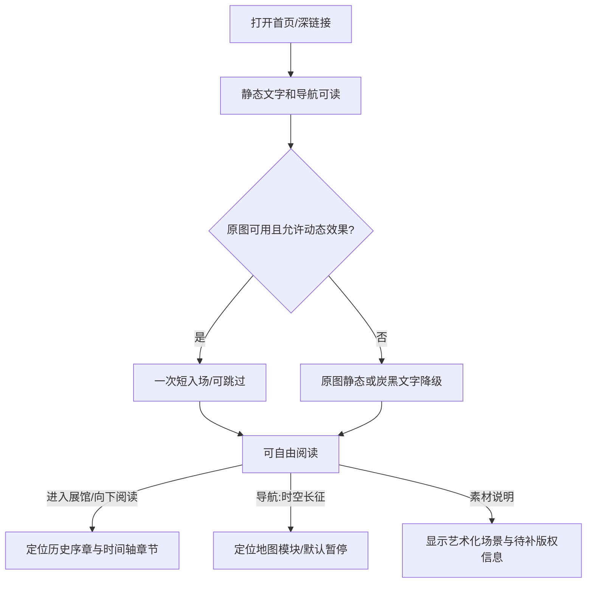
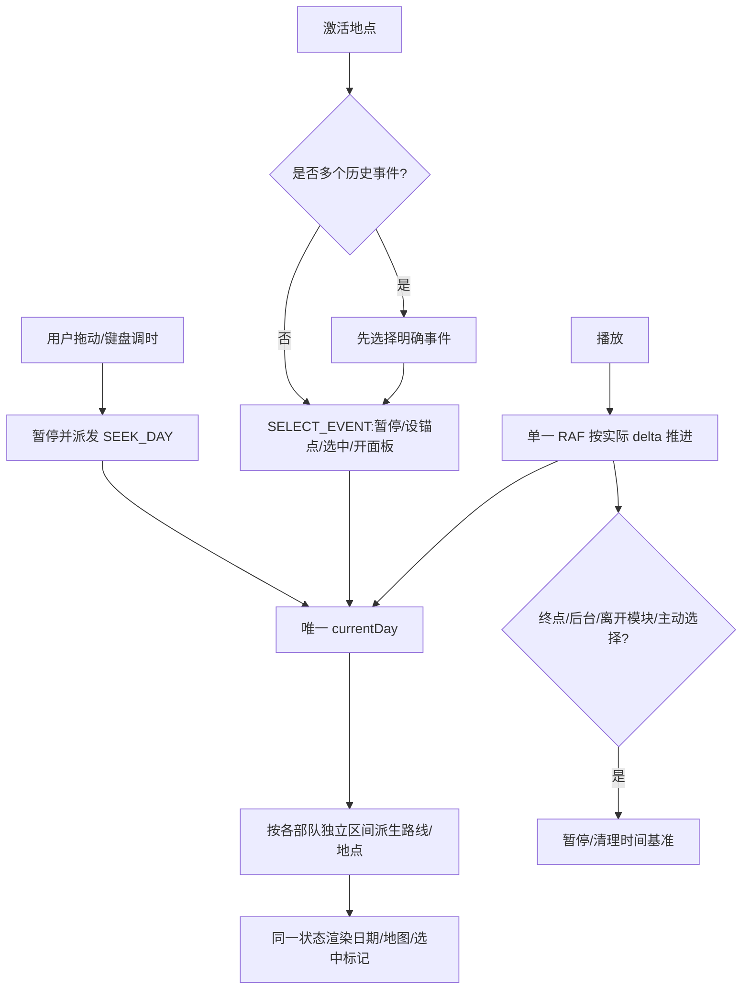

# 交互设计说明

版本：0.2；更新：2026-11-07（Day 2）；状态：设计提案，待用户确认、待原型验证。覆盖 FR-01—FR-15，保留 Day 1 状态与历史精度规则。下文 Day 2 细则补齐桌面/移动尺寸及状态反馈，不代表功能已实现。

## 入口与滚动叙事

首页首先呈现可读标题和静态影像，再渐进增强标题入场。提供进入展馆、跳过片头和章节导航。资源失败或减少动态效果时可直接阅读；不得让预加载动画永久遮挡正文。章节固定与视差只在阅读有益时采用，移动端可直接纵向阅读。

用户滚动章节只改变阅读位置。历史模拟时间由地图时间轴、事件选择、播放控制改变，避免同时存在滚动和播放两套时钟。离开地图模块暂停；返回仍保持日期与筛选，不自动恢复播放。

## 时空长征布局

桌面：上方历史时间轴，中央完整地图，右侧资料栏，下方播放与部队筛选。右侧列宽在打开前后保持，避免面板动画反复改变地图比例；必要时只调整地图内部视野，不遮住核心控件。

移动：地图与时间轴依次排列，事件列表提供完整替代操作；资料采用底部对话框方案候选，内容独立滚动。打开时焦点进入对话框，Escape/关闭退出并恢复触发点；背景不可误操作。最终面板模式第 2 天确认。

## 统一状态和事件

| 输入 | 状态变化 | 必须满足的约束 |
| --- | --- | --- |
| SEEK_DAY(day) | 裁剪到全局有效范围并更新 currentDay | 同一帧派生所有路线、标记；不另存地图时间 |
| DRAG_START | 暂停，记录拖动状态 | 捕获 pointer；拖动不触发页面平滑滚动 |
| DRAG_MOVE | 根据指针计算日序，更新 SEEK_DAY | 每 RAF 至多处理一次最新位置，显示当前日期 |
| DRAG_END / CANCEL | 提交最后日期，结束捕获 | 保持暂停，用户明确点击才再播放；取消也不能遗留拖动状态 |
| SELECT_EVENT(id) | 暂停、定位事件展示锚点、选中事件和地点、打开面板 | 一个原子 action，不靠两个 effect 互相监听同步 |
| SELECT_PLACE(id) | 单事件直接选择，多事件先列日期选择器 | 多日期地点不擅自选定首次发生日期 |
| PLAY / PAUSE | 更改播放状态，重置时钟基准 | 终点按 PLAY 从起点重播，先向用户明确显示“重播” |
| SET_SPEED(value) | 切换 0.5×/1×/2× | 不重置日期；禁止重复建立 RAF |
| TOGGLE_ARMY(id) | 仅改变可见集合 | 不改变日期；若详情仅属于隐藏部队则关闭详情并说明 |
| ENTER_SOLO / EXIT_SOLO | 保存/恢复筛选和视野 | P2；不改全局时间，不误覆盖用户日期选择 |
| CLOSE_DETAIL | 清空选中事件/地点 | 保留日期与筛选，焦点返回触发控件 |
| VISIBILITY_HIDDEN / UNMOUNT | 暂停并清理时钟 | 恢复前台不追赶后台经过的时间 |

拖动时间轴支持 Pointer Events，处理 pointercancel。键盘提供方向键逐日、PageUp/PageDown 按较大步长、Home/End 到起止点，以及前后事件按钮；细步长与大步长需在原型中说明。滑块提供 aria-valuemin/max/now 和 aria-valuetext 日期；屏幕阅读器播报节流到停止拖动或关键节点，不能每帧刷屏。

## 多部队路线规则

1. 全局范围由经审核的数据有效区间求并集，不假设所有部队同时开始和结束。
2. 日期早于某支部队有效起点：不显示该部队轨迹，图例显示“尚未进入本路线时间范围”。晚于终点：保留完整轨迹并标识结束。
3. 到达节点之间按分段时间推进；停驻期间路线不延伸；退拖时撤销未来段和未来地点。存在时间缺口时不制造精确运动。
4. 插值仅用于表达时间进展，面板和图例明确“路线示意/节点级”，不能宣称当日精确位置。
5. 部队颜色固定，配线型和文字；交汇地点显示各部队各自到达的事件，不通过坐标接近自动推断会师。
6. 编制与名称变化由有效时期决定，关联前身/后继关系，不共用一个永久名称掩盖历史差异。

## 地点、详情与时间双向联动

地点在其关联的第一条可展示事件达到 revealDay 后出现；同地点后续事件只在已发生/可查看列表中显示。选中列表中的明确事件，可主动调时到其锚点。对仅精确到月或区间的事件，显示完整日期文本和“按区间起点定位”的说明；锚点不是新增史实。

点击地点后先停止播放，再执行 SELECT_EVENT；资料面板显示标题、原始日期、部队、背景、图像及来源。定位完成不自动播放。时间轴拖至其他时间：如选择事件已在未来则关闭详情，避免未来信息残留；已发生事件可保持，但显示事件日期与当前日期的区别。

普通探索不强制更改筛选。如果来自其他模块的“查看地图”指向隐藏部队，则明确显示“显示相关部队并定位”，用户触发该操作才把相关部队加入集合。部队全部关闭时保留时间控制和空状态，提供恢复全部按钮。

## 自动播放计算

候选基础速率为 1× 每秒推进 7 个历史日，待原型评估；0.5×、2×为相对倍率。使用单一 RAF 累积实际 delta，支持小数内部进度，展示和事件判定基于整日。不以屏幕帧数决定速度。最后一帧精确钳制到终点后暂停，重播明确从起点开始。暂停和倍速切换重新建立基准时间，不能发生时间跳跃。

## 降级与边界

- 减少动态效果不影响历史播放的显式操作，但取消装饰视差和自动飞行镜头。
- 地图缩放/拖动与页面滚动分开；只有地图操作区拦截必要事件，不锁住整页。
- 空数据/未核实地点不进入正式选择列表；可显示“资料待补充”，不能伪造位置。
- URL 可选保存日期、部队和事件；参数需校验，非法参数回退默认暂停态。默认日期取审核数据起点。
- 深链接不得让未来事件在较早时间偷偷显现；加载完成后用一个 action 解析并恢复一致状态。

第 5—7 天重点验证：拖动可逆、跨部队不同起止时间、同地点多事件、播放终点、隐藏选中部队、后台恢复、键盘与移动触摸，详见 [测试计划](TEST_PLAN.md)。

## Day 2 首页完整交互流程

首页 A/B 视觉候选见 [DESIGN_SYSTEM.md](DESIGN_SYSTEM.md)，两套共用相同语义与导航。初始状态为 static-ready；文字与导航从 DOM 初始内容即可读取。图片可用时才进入短暂 intro 动效，失败进入 static-fallback，不能出现不可退出的全屏遮挡。关键资源未就绪时主按钮仍可操作，不伪造百分比。



“进入展馆”不暗示播放影片，也不擅自开始地图自动播放；目标为序章/历史时间轴章节首标题。键盘激活章节链接后将阅读焦点放到目标标题，浏览器返回应恢复原位置。滚动提示是可点击链接，名称“向下阅读”，不是只能看不能操作的箭头。鼠标自然滚动不强行转移焦点。

导航为：首页、历史时间轴、时空长征、历史瞬间、英雄人物、精神传承。小屏菜单由明确按钮展开，aria-expanded 同步；模态菜单支持 Escape、焦点约束和恢复。素材说明与菜单不能同时叠出两层模态，打开新层前关闭旧层。

## Day 2 地图布局与信息层级

### 桌面（≥1024px）

```text
┌ 标题:时空长征                  资料精度/使用说明 ┐
│ 当前日期      前一事件 ──时间轴── 后一事件       │
├────────────────────────┬───────────────────────┤
│ 完整中国地图            │ 历史资料栏            │
│                        │ 未选中:操作说明       │
│ 多部队轨迹 / 地点       │ 已选中:事件档案       │
│ 缩放、复位 / 必要附图   │ 日期/部队/来源/关闭   │
├────────────────────────┴───────────────────────┤
│ 播放/暂停  0.5× 1× 2×   部队筛选（可换行）     │
└────────────────────────────────────────────────┘
```

总容器最大 1280px。侧栏 320—360px，列间距 24px，地图区至少 600px 宽、420px 高，空间不足转移动布局或自然增高，不能压到标签互相覆盖。时间轴区建议 96—120px，底部控件区至少 96px；整体可高于一屏，不将地图变成锁住页面的全屏系统。

侧栏初始显示简短操作说明与精度说明，选择后在同一列替换为资料；它不是遮盖地图的悬浮广告层。按“关闭”恢复说明并保留日期与筛选。若未来需要地图扩大模式，必须有显式“扩大地图/恢复布局”，不作为当前 P0 隐藏功能。

地图以正规完整底图为初始视野，路线局部缩放是可选探索，不把完整地图切为只剩路径的缩略图。保留复位按钮、文字事件列表和来源入口；底图加载失败时显示事件列表，不能用随手画的轮廓冒充准确地图。

### 平板与移动（<1024px）

顺序为：章节标题→当前日期与前后事件→时间轴→完整地图→播放/倍速→可换行部队筛选→等价事件列表。地图高度建议 clamp 到 320—440px，窄竖屏保持底图全貌，不为了塞满地图任意裁切中国范围；支持可见缩放按钮，不能只能双指缩放。

小屏不常驻右栏。选中后打开底部资料对话框（建议最大 82svh），标题/关闭置顶、正文独立滚动，背景 inert 并暂停播放。关闭按钮始终可达；Escape/系统返回按栈关闭当前层后恢复触发点焦点。拖动手柄仅可作为辅助，不要求用户必须拖动关闭。放大字体、横竖屏切换时面板高度重新约束。

移动地图默认单指纵向滑动仍允许阅读页面，进入显式“移动地图”模式后才由单指拖拽地图；提供“退出地图操作”和复位。时间轴只在轨道自身处理水平拖动，pointercancel/手指离开后清理捕获；背景 Lenis 不拦截这两个操作区。

## 时间轴刻度与操作反馈

时间范围取所有审核部队数据区间的并集，初始日为其最早有效锚点，不预填统一出发年份或日期。所有日期统一以公历格式展示，精确到月/区间时显示原始精度与锚点说明；暂定 1936—2026 只用于首页纪念文案，绝不作为地图时间范围。

- 桌面优先按年显示主刻度、按季/月根据空间自动抽稀，移动保留起止与当前时间，不缩小到不可读字号。事件节点聚集用“该时段 n 项事件”列表入口，n 从真实数据计算。
- 当前日期黑体 20px，主滑块可见 16px、命中区 44px。重要事件刻度是短线/小点，与部队颜色、拖动把手区别；鼠标悬停可显示标题，键盘聚焦提供同样信息。
- 方向键逐日，PageUp/PageDown 暂定 30 日，Home/End 到界限；前/后事件按钮定位审核事件而非机械加一天。操作说明可展开，键盘不得被平滑滚动截获。
- 输入即时更新日期与派生路线。拖动时暂停并只保留最后一个待绘制位置，每帧最多一次更新；不在 pointerup 后额外缓动到另一日期。进度百分比表示展示时间进度，不表示历史路程或历史完成度。
- 日期有效边界的前后按钮 disabled 并保留解释；缺日期事件留在资料列表，不制造精确位置以适配时间轴。

## 地图路线、标记与筛选细则

四部队候选配色、符号与对比度见设计系统。默认展示全部有合格数据的部队，名称取当日有效番号；四个候选身份不得被误当四条已经核实的历史路线。

- 路线常态 2.5px、选中 4px，底衬深色线比主体宽 3px，缩放后保持屏幕可辨粗细。未选路线保留可读对比度，不统一降成近乎消失的低透明线。
- 交叉点选择先列相关部队/事件；聚集标签在屏幕坐标中避让，用引线联系实际点，不移动历史经纬度；缩放时更新避让，键盘列表无需依赖避让算法。
- 当前“行军进度”以所属部队形状+文字高亮，不称“当日精确位置”，除非数据本身支持该精度。停驻时不移动；缺口不做流光穿越；没有数据不做精确插值。
- 起点用空心部队形状、终点用双轮廓相同形状；会师地点用共享外环和相关事件列表，并明确参与部队与各自日期。会师图标的出现必须由核实事件驱动，不根据路线交叉自动生成。
- 筛选使用可切换按钮/复选框，含完整名称、符号和选中勾；未显示状态保留边框与“已隐藏”语义。有资料缺口/数据未就绪的部队显示说明，不伪造空轨迹为完整路线。
- 全部关闭时地图底图与时间保持，显示“暂无可见部队”及“显示全部”按钮。隐藏所属部队使当前档案失去全部可见关联时，关闭档案、清理选择并简短播报原因，焦点回筛选。
- 单部队模式为 P2：保存此前筛选和视野；仅改变可见集合和可选视野，退出恢复；日期继续来自唯一 currentDay。

## 历史资料卡片结构与状态

资料顺序：地点名称→事件名称→原始历史日期/精度→相关部队→图片及类型/署名→事件简介→历史背景→历史意义→资料来源。采用有小标题的阅读段落，不把每段又包成子卡片。图片无权限或缺失时直接用文字，不显示假照片占位。来源包括资料标题、机构、网页链接/页码、审核状态；外链有明确语义。

| 状态 | 展示与行为 | 焦点/播放 |
| --- | --- | --- |
| closed | 桌面显示操作说明；移动无面板 | 日期与筛选保留 |
| choosing-event | 同地点多个事件，先展示各自日期与标题 | 暂停，不猜选首日；可返回 |
| opening | 使用已选事件填充固定区域，280ms 局部转场 | 播放已暂停；不等动画结束才显示内容 |
| ready | 全文、图片、引用、关闭可用 | 桌面非模态不困住 Tab；键盘选中可焦点到标题，指针激活不突然抢走焦点 |
| loading-media | 正文和来源立即可读，预留图片比例 | 不用大遮罩盖住全文 |
| media-error | 显示“图片未能加载”和既有署名，保留正文 | 可重试；不得永久旋转 |
| data-error | 显示“资料暂不可用”、返回列表或关闭 | 不改变 currentDay，不以未经审核内容填充 |
| closing | 180—220ms 淡出；reduce 立即关闭 | 移动解除 inert，恢复触发点；触发点消失则回事件列表标题 |

动画开合期间的重复点击以最新有效选择为准，取消旧媒体任务/回调，不把前一个事件的图像错配到新资料。移动对话框与桌面非模态行为不能共用一个错误的全局焦点陷阱。

## 双向联动与播放状态流程



基本状态：paused、playing、dragging、ended；档案状态与播放状态正交存储，但 SELECT_EVENT 必先暂停。状态转换：paused→PLAY→playing；playing→PAUSE/选择事件/后台→paused；任意可交互态→DRAG_START→dragging→DRAG_END/CANCEL→paused；playing 到终点→ended；ended 的按钮明确显示“从头播放”，主动触发后复位并播放。

播放默认暂停，倍率 0.5×/1×/2×为单选；基础候选仍为每秒 7 个历史日，Day 5 依据可读性调整。关键事件到达时给予一次静态日期提示和“查看资料”入口，不自动打开大面板、不夺焦点、不自动飞行地图；多个事件跨帧到达合并计数，完整历史事件可在列表查阅。任何自动提示不可盖住暂停按钮。

播放日期与路线在同一状态帧派生，不先播装饰路径再补日期。暂停立即停止进度，不等待面板/路线动画结束。reduce 模式保留用户明确触发的历史模拟播放，但禁用装饰视差、呼吸光和飞行镜头；播放本身有持续可见暂停入口。关闭资料后不会偷偷恢复播放。

## 无障碍、异常与验收补充

当前节点/日期的可访问名称含部队、事件和日期精度；屏幕阅读器在停止拖动或用户选择时播报，自动播放不每帧打断阅读。地图提供同等可操作的事件列表；与时间轴共用状态，不复制第二套选中逻辑。

加载空数据时控件禁用并解释，无审核数据时不播放；资源超时不影响正文；非法 URL 值裁剪/回退默认暂停；隐藏部队深链接须通过明确“显示相关部队并定位”操作才改变集合。窄屏、字体加载失败、图片失败和减少动态效果都保留关闭、复位、来源和前后事件入口。

本轮验收限文档：A/B 方案未定稿、未实现页面；Day 3 检查首页真实裁剪与对比度，Day 5—7 按 TEST_PLAN 的 T-MAP/T-PLAY/T-A11Y 用例测试；尺寸提案不能冒充浏览器和设备实测结果。
